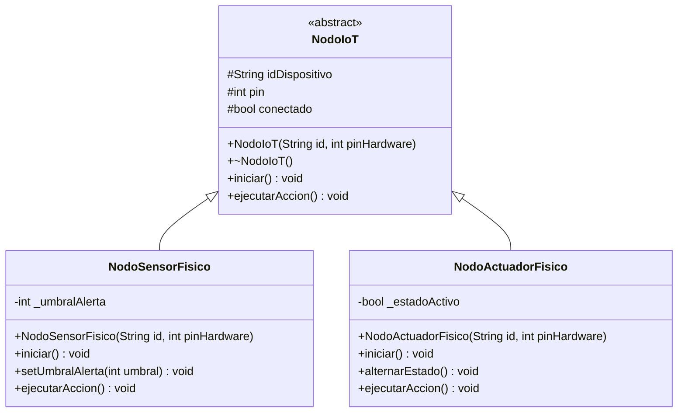

# Práctica 3 — Avance de desarrollo, Semana 2

## Implementación Física de Nodos IoT Heterogéneos en C++ (ESP32)

**Asignatura:** Programación Orientada a Objetos  
**Fecha de actualización:** 11 de noviembre de 2026  
**Etapa:** Semana 2 — implementación de la arquitectura de clases  
**Lenguaje y plataforma:** C++ con entorno Arduino para ESP32  
**Estado:** Superclase y subclases desarrolladas a nivel de código fuente; integración y pruebas físicas pendientes

---

## 1. Introducción

Durante la Semana 1 se estableció el diseño preliminar para trasladar el sistema modular de nodos IoT de la Práctica 2, desarrollado en Python, hacia una implementación física en C++ con un microcontrolador ESP32. Se propuso una superclase `NodoIoT`, dos subclases especializadas y un programa principal capaz de tratar sensores y actuadores mediante polimorfismo.

En esta segunda semana se cuenta con los archivos de cabecera **`NodoIoT.h`** y **`NodosFisicos.h`**, además de un documento de instrucciones que explica las decisiones del código. Estos archivos permiten identificar avances concretos en la aplicación de herencia, encapsulamiento y métodos virtuales. El proyecto ahora dispone de la estructura de clases necesaria para realizar lecturas analógicas y controlar salidas digitales, aunque **todavía no se ha aportado el archivo principal de Arduino ni evidencia de compilación o funcionamiento en el ESP32**.

El presente reporte actualiza lo descrito en la Semana 1 tomando como referencia las implementaciones efectivamente incluidas en los archivos entregados.

## 2. Objetivo del avance

Implementar en C++ la superclase `NodoIoT` y las subclases `NodoSensorFisico` y `NodoActuadorFisico`, conservando la estructura de programación orientada a objetos propuesta anteriormente y preparando sus métodos para interactuar con los GPIO del ESP32.

**Resultados observables en los archivos:**

- Definición de una clase abstracta `NodoIoT` con un método virtual puro.
- Implementación de herencia pública y reutilización del constructor base mediante listas de inicialización.
- Protección de los atributos específicos de sensores y actuadores mediante `private:`.
- Validación del umbral de lectura del sensor en el intervalo de `0` a `4095`.
- Inclusión de llamadas a `pinMode()`, `analogRead()`, `digitalWrite()` y `Serial`.
- Sobrescritura de `iniciar()` y `ejecutarAccion()` usando `override`.

## 3. Continuidad respecto de la Semana 1

| Elemento | Semana 1: diseño | Semana 2: código entregado |
|---|---|---|
| Superclase común | Se propuso `NodoIoT`. | Existe `NodoIoT.h`, con constructor, atributos protegidos y métodos virtuales. |
| Especialización de nodos | Se plantearon dos clases derivadas. | Ambas están implementadas en `NodosFisicos.h`. |
| Encapsulamiento | Se definió un umbral privado y un estado privado. | Se implementaron `_umbralAlerta` y `_estadoActivo` como `private`. |
| Lectura analógica | Se propuso utilizar un sensor ADC. | `NodoSensorFisico::ejecutarAccion()` contiene `analogRead(pin)`. |
| Salida digital | Se propuso un LED o relé. | `NodoActuadorFisico::ejecutarAccion()` contiene `digitalWrite()`. |
| Bucle polimórfico | Se documentó un ejemplo de `NodoIoT*`. | No se entregó todavía el archivo principal que construya y recorra el arreglo. |
| Montaje y evidencias | Pendientes. | Siguen pendientes de comprobar. |

## 4. Desarrollo de la superclase `NodoIoT`

En **`NodoIoT.h`** se implementó la clase padre con tres atributos declarados como `protected`:

- `String idDispositivo`: identifica cada sensor o actuador.
- `int pin`: almacena el número de GPIO asignado.
- `bool conectado`: representa el estado lógico de inicialización que utilizan las subclases.

El constructor `NodoIoT(String id, int pinHardware)` recibe el identificador y el pin físico, y establece inicialmente `conectado = false`.

También se incorporó un **destructor virtual** (`virtual ~NodoIoT() {}`), apropiado para una jerarquía utilizada a través de punteros a la clase base. El método `iniciar()` se declaró virtual y dispone de una implementación base vacía. De esta manera, cada tipo de nodo puede definir su propia configuración.

La instrucción más relevante es:

```cpp
virtual void ejecutarAccion() = 0;
```

El símbolo `= 0` convierte este método en **virtual puro** y hace que `NodoIoT` sea una clase abstracta: no es posible crear directamente un objeto de esa clase. Sus subclases concretas deberán proporcionar una implementación de `ejecutarAccion()`.

**Aclaración técnica:** aunque el atributo se llama `conectado`, en el código actual las subclases lo cambian a `true` después de configurar el pin. Esto **no demuestra una conexión Wi-Fi ni comunicación con otros nodos**; por ahora representa la inicialización lógica de cada dispositivo.

## 5. Desarrollo de las subclases físicas

### 5.1. `NodoSensorFisico`: lectura de entradas analógicas

La clase se declara mediante herencia pública:

```cpp
class NodoSensorFisico : public NodoIoT {
```

Su constructor utiliza la lista de inicialización `: NodoIoT(id, pinHardware)` para reutilizar el constructor de la superclase. El atributo privado `_umbralAlerta` se inicia con el valor **2048**, aproximadamente el punto medio del intervalo digital de un ADC de 12 bits.

Se implementó el método público `setUmbralAlerta(int umbral)`, que acepta únicamente valores enteros entre **0 y 4095**. Si se recibe un valor fuera del intervalo, el código conserva el umbral anterior e imprime un mensaje de error mediante `Serial.println()`.

En `iniciar()`, la subclase configura el GPIO como `INPUT` y establece `conectado = true`. Posteriormente, `ejecutarAccion()` realiza la lectura:

```cpp
int lectura = analogRead(pin);
```

El valor se envía al monitor serie junto con el identificador del nodo. Cuando `lectura > _umbralAlerta`, se agrega un mensaje de alerta. La comparación utiliza el valor **digital bruto del ADC**, no una temperatura ni un porcentaje de humedad convertido a unidades físicas.

**Alcance:** el código incluye la lectura y la lógica de comparación, pero no se han aportado valores obtenidos de un sensor conectado. La validación de `0–4095` protege la configuración del umbral en software; **no sustituye las precauciones de voltaje permitidas en la entrada física**.

### 5.2. `NodoActuadorFisico`: control de salidas digitales

La segunda subclase también hereda públicamente de `NodoIoT` y utiliza una lista de inicialización para su constructor. Contiene el atributo privado `_estadoActivo`, que inicia en `false`.

El método `iniciar()` configura el pin como `OUTPUT`, escribe `LOW` para establecer el estado inicial de apagado y cambia `conectado` a `true`.

El método `alternarEstado()` invierte el valor del atributo privado:

```cpp
_estadoActivo = !_estadoActivo;
```

Por su parte, `ejecutarAccion()` aplica ese estado al GPIO:

```cpp
digitalWrite(pin, _estadoActivo ? HIGH : LOW);
```

También imprime en el monitor serie el estado **ENCENDIDO** o **APAGADO**. Es importante señalar que **`alternarEstado()` modifica primero el estado lógico y la salida física se actualiza cuando se llama a `ejecutarAccion()`**.

La implementación actual corresponde a una **salida digital ON/OFF**. No se incluye todavía control PWM mediante `ledcWrite()`, ni una regla automática que encienda el actuador a partir de la lectura del sensor.

## 6. Aplicación de los principios de programación orientada a objetos

| Principio | Aplicación identificada |
|---|---|
| **Abstracción** | `NodoIoT` define una interfaz común para dispositivos diferentes y no puede instanciarse directamente. |
| **Herencia** | `NodoSensorFisico` y `NodoActuadorFisico` derivan de `NodoIoT` y reutilizan su constructor. |
| **Encapsulamiento** | `_umbralAlerta` y `_estadoActivo` son privados; se modifican a través de métodos públicos. |
| **Polimorfismo** | `iniciar()` y `ejecutarAccion()` están sobrescritos con `override`; cada objeto tiene su propia implementación. |

La arquitectura ya está preparada para realizar llamadas mediante punteros a `NodoIoT`. Sin embargo, la **demostración del recorrido polimórfico dentro de `setup()` y `loop()` continúa pendiente**, porque ese archivo no forma parte de los materiales entregados.

## 7. Diagrama UML actualizado según el código

El siguiente diagrama refleja los nombres y métodos presentes en los dos archivos `.h`, en lugar de conservar las denominaciones provisionales de la Semana 1.



**Convenciones:** `+` es público, `#` es protegido y `-` es privado. En el código C++, `ejecutarAccion()` de `NodoIoT` es virtual puro; `iniciar()` y el destructor son virtuales.

## 8. Integración pendiente en el ESP32

Se conserva la propuesta de conectar **una entrada analógica** (por ejemplo, un potenciómetro o un LDR con divisor de tensión) y **una salida digital** (por ejemplo, un LED con resistencia limitadora). Como referencias de diseño, en la Semana 1 se consideraron GPIO **34** y **23**, respectivamente, para un ESP32 clásico. **Los archivos de cabecera no fijan esos pines ni prueban que el montaje ya exista**: ambos reciben el número de GPIO por constructor.

El siguiente paso consiste en crear un archivo principal `.ino` o `main.cpp` que incluya `NodosFisicos.h`, declare objetos de ambos tipos y almacene sus direcciones en un arreglo de punteros `NodoIoT*`.

**Estructura de integración prevista — ejemplo no entregado ni probado:**

```cpp
#include "NodosFisicos.h"

NodoSensorFisico sensor("SENS_ADC", 34);
NodoActuadorFisico actuador("ACT_LED", 23);
NodoIoT* red[] = {&sensor, &actuador};

void setup() {
    Serial.begin(115200);
    for (NodoIoT* nodo : red) {
        nodo->iniciar();
    }
}

void loop() {
    for (NodoIoT* nodo : red) {
        nodo->ejecutarAccion();
    }
    delay(500);
}
```

Este ejemplo únicamente muestra **cómo podría integrarse** el arreglo polimórfico con las clases existentes. El estado del actuador permanecería apagado hasta invocar `alternarEstado()` desde otra parte del programa. No se presenta como código ya desarrollado por el equipo ni como evidencia de compilación.

## 9. Organización de archivos propuesta

La estructura se actualiza para reflejar los nombres realmente utilizados:

```text
repositorio/
├── .gitignore
├── AUTHORS.md
└── practica-03/
    ├── src/
    │   ├── NodoIoT.h                 # Código entregado
    │   ├── NodosFisicos.h            # Código entregado
    │   └── practica_03.ino           # Pendiente de integrar
    └── docs/
        ├── Avance_Semana_01_Practica_03.md
        ├── Avance_Semana_02_Practica_03.md
        ├── Reporte_Evidencias_P3.pdf  # Pendiente
        └── evidencias/                 # Pendiente
```

Esta estructura es una **propuesta de ubicación dentro del repositorio**, no una comprobación de que los archivos ya estén publicados en GitHub. El documento `instrucciones.md` menciona la ruta `include/NodoIoT.h`; si se utiliza PlatformIO, puede mantenerse una carpeta `include/` para las cabeceras y `src/` para `main.cpp`, de acuerdo con la configuración del proyecto. La ubicación definitiva debe ser consistente con el entorno seleccionado.

## 10. Matriz de avances y evidencias

| Requisito | Estado al cierre del avance | Evidencia disponible o pendiente |
|---|---|---|
| Clase base `NodoIoT` | **Implementada en archivo de cabecera** | `NodoIoT.h` |
| Herencia de sensor y actuador | **Implementada en código** | `NodosFisicos.h` |
| Constructor base mediante lista de inicialización | **Implementado en código** | Constructores de ambas subclases |
| Encapsulamiento del umbral | **Implementado en código** | `_umbralAlerta`, `setUmbralAlerta()` |
| Encapsulamiento del estado de actuador | **Implementado en código** | `_estadoActivo`, `alternarEstado()` |
| Métodos virtuales y `override` | **Implementados en código** | Archivos `.h` |
| Lectura ADC y salida digital | **Instrucciones presentes en código** | `analogRead()`, `digitalWrite()`; falta prueba física |
| Arreglo de punteros `NodoIoT*` | **Pendiente de integración** | Falta archivo principal |
| Monitor serie a 115200 baudios | **Pendiente de comprobar** | Falta programa principal y captura real |
| Compilación para ESP32 | **No verificada** | Falta registro de compilación |
| Circuito en protoboard | **No verificado** | Faltan fotografías y esquema real |
| Demostración de funcionamiento | **Pendiente** | Faltan lecturas, estados y video público |
| Reporte final en PDF | **Pendiente** | `practica-03/docs/Reporte_Evidencias_P3.pdf` |

## 11. Plan de pruebas para la siguiente etapa

Una vez integrado el programa principal, se recomienda comprobar los siguientes casos, guardando resultados auténticos:

1. **Inicialización:** verificar que un sensor se configure como entrada y un actuador como salida, comenzando este último en `LOW`.
2. **Lectura analógica:** variar el sensor y observar cambios de `analogRead()` en el monitor serie a 115200 baudios.
3. **Validación del umbral:** probar `0`, `2048` y `4095` como valores válidos; probar `-1` y `4096` como valores rechazados.
4. **Alerta:** verificar que se muestre solo cuando la lectura supere el umbral (`>`), y no cuando sea igual.
5. **Cambio de estado:** llamar a `alternarEstado()` y después a `ejecutarAccion()` para observar el cambio de la salida.
6. **Bucle polimórfico:** invocar `ejecutarAccion()` desde un arreglo `NodoIoT*` y verificar que se ejecute el comportamiento correcto de cada subclase sin comparar tipos.
7. **Evidencias físicas:** documentar esquema de conexiones, fotografías del ESP32 montado y video de máximo 3 minutos.

**Revisión técnica recomendada:** confirmar los GPIO y los límites eléctricos de la placa concreta. El rango numérico `0–4095` corresponde a una lectura ADC de 12 bits configurada de ese modo; no significa que la entrada admita cualquier voltaje. Si se utiliza un relé o motor, debe comprobarse el circuito de accionamiento apropiado y no conectarlo directamente a un GPIO sin la interfaz necesaria.

## 12. Actividades de la próxima semana

1. Crear el archivo principal `.ino` o `main.cpp` y configurar `Serial.begin(115200)`.
2. Instanciar al menos un sensor y un actuador, y construir el arreglo `NodoIoT*`.
3. Recorrer el arreglo desde `setup()` y `loop()` con llamadas virtuales.
4. Compilar para el modelo específico de ESP32 y corregir errores, si aparecen.
5. Montar y probar el circuito real con conexiones seguras.
6. Comprobar el cambio de lecturas y el encendido/apagado del actuador.
7. Tomar capturas del monitor serie y fotografías del montaje.
8. Preparar el esquema de conexiones y el video demostrativo.
9. Integrar todas las evidencias verificadas en el reporte final PDF.

## 13. Conclusión del avance

El avance de la Semana 2 representa un progreso respecto al diseño inicial: **la superclase y las dos subclases ya están escritas en C++**, con relaciones de herencia, atributos encapsulados y métodos polimórficos. El sensor dispone de instrucciones para leer una entrada analógica y generar alertas por umbral; el actuador dispone de instrucciones para controlar una salida digital y reportar su estado.

La arquitectura se mantiene modular y permite reutilizar el mismo contrato `ejecutarAccion()` en dispositivos diferentes. La siguiente etapa será integrar estas clases con el programa principal, verificar la compilación y comprobar su comportamiento sobre el ESP32 real. Solo después de esas pruebas podrán declararse como cumplidos el montaje físico y la demostración del sistema.

---

**Nota de evidencia:** este reporte se basa en los archivos `NodoIoT.h`, `NodosFisicos.h` e `instrucciones.md`. Describe lo que el código contiene, pero no atribuye compilaciones, mediciones, fotografías ni demostraciones que todavía no se han proporcionado.
