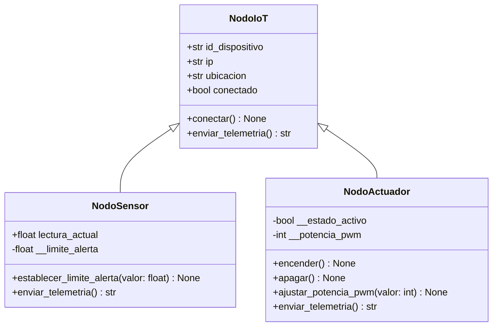

Práctica 2 — Avance de desarrollo, Semana 1 y 2
Sistema Modular de Nodos IoT: Herencia y Polimorfismo en Python
Asignatura: Programación Orientada a Objetos  
Fecha de entrega indicada: 07 de noviembre de 2026  
Etapa del documento: Semana 1 — diseño preliminar  
Modalidad: Simulación 100 % en Python, sin montaje ESP32 en esta práctica  
Reporte final requerido: `practica-02/docs/Reporte_Evidencias_P2.pdf`
Integrantes del equipo
Nombre	Matrícula	Usuario de GitHub
Jose Maximiliano Hernandez Loeza	S23013991	`Maxloeza18`
Emmanuel Perez Viveros	S23013933	`Emma612-bit`
Daniel Isaac Izquierdo Hernandez	S23013986	`DaniLeft`
---
1. Introducción
La segunda práctica plantea la evolución de los programas de sensores y actuadores desarrollados en la Práctica 1 hacia una arquitectura de software modular. En lugar de representar cada dispositivo mediante clases aisladas, se propone una superclase `NodoIoT` que concentra las características y operaciones compartidas. A partir de ella se derivarán `NodoSensor` y `NodoActuador`, cada una con atributos y comportamientos específicos.
El avance de esta primera semana se enfoca en definir la arquitectura de clases, documentar el uso previsto de herencia, encapsulamiento y polimorfismo, y establecer la organización del repositorio. El propósito es contar con un diseño revisable antes de iniciar o concluir la implementación en Python.
> **Alcance de la evidencia:** este documento contiene una propuesta de diseño elaborada a partir de las indicaciones de la práctica. No se han aportado todavía código ejecutable de la Práctica 2, capturas de consola ni enlaces de video; por lo tanto, **no se reportan como pruebas realizadas**.
2. Objetivo del avance
Diseñar la estructura de un sistema modular de nodos IoT simulados, identificando las responsabilidades de una clase padre y dos subclases, así como el mecanismo con el que una lista heterogénea de objetos podrá generar telemetría mediante llamadas polimórficas.
Resultados esperados para la primera etapa: contar con una propuesta de diagrama UML, un esquema de organización de archivos y criterios preliminares para validar atributos privados y sobrescribir métodos, listos para convertirse en código y evidencias de ejecución.
3. Semana 1 — Análisis y diseño
3.1 Sesión 1.1 — Definición de la arquitectura
Se establece como diseño base una estructura de tres clases:
Clase	Responsabilidad	Elementos clave
`NodoIoT`	Compartir la identidad y conexión de los dispositivos	`id_dispositivo`, `ip`, `ubicacion`, `conectado`, `conectar()`, `enviar_telemetria()`
`NodoSensor`	Representar nodos de medición	Herencia con `super()`, `__limite_alerta`, setter validado, lectura actual y sobrescritura de telemetría
`NodoActuador`	Representar nodos de actuación	`__estado_activo`, `__potencia_pwm`, `encender()`, `apagar()` y sobrescritura de telemetría
La lógica común se concentrará en `NodoIoT`, mientras que las clases hijas conservarán la responsabilidad de interpretar y mostrar la información que les corresponde. Así se busca evitar duplicación y facilitar la incorporación futura de más tipos de nodos.
Como criterio inicial, el atributo `conectado` indicará si un nodo se encuentra disponible en la simulación; el método `conectar()` se encargará de actualizar ese estado. Su comportamiento definitivo se verificará al implementar la clase padre.
3.2 Sesión 1.2 — Propuesta de diagrama UML
El siguiente diagrama es una propuesta inicial de clases. La notación `+` indica elementos públicos y `-` elementos privados. Las flechas apuntan a la superclase `NodoIoT`. Los atributos y métodos adicionales respecto de la guía, como `lectura_actual` o `ajustar_potencia_pwm()`, son decisiones propuestas para facilitar la implementación y deberán confirmarse al programar.

Observación para la entrega: el diagrama deberá exportarse posteriormente como imagen e incorporarse al PDF final, de modo que sea legible aun en visores que no interpreten Mermaid.
3.3 Criterios de encapsulamiento
Para `NodoSensor`, el límite de alerta se mantendrá en el atributo privado `__limite_alerta`. Su modificación se realizará por medio de un setter que verifique que el dato sea numérico, finito y compatible con el rango de medición definido para el sensor. Los límites concretos dependerán del tipo de sensor simulado y deberán establecerse en la implementación.
Para `NodoActuador`, el estado de encendido y la potencia estarán protegidos mediante `__estado_activo` y `__potencia_pwm`. Los métodos públicos serán la vía para modificar estos valores. Como propuesta, si se adopta PWM de 8 bits, se validará un intervalo entero de `0` a `255`; esta resolución no está fijada explícitamente en las indicaciones de la Práctica 2.
Durante las pruebas se contemplará verificar que los valores fuera de rango no modifiquen el estado del objeto. El mecanismo para informar errores (por ejemplo, mediante `ValueError`) se definirá al implementar los métodos.
3.4 Diseño del bucle polimórfico
El programa principal utilizará una colección con distintos tipos de nodos. El método `enviar_telemetria()` será llamado sin preguntar de qué clase es cada objeto:
```python
# Estructura prevista para la implementación (ejemplo de diseño)
red_iot = [sensor_temp, actuador_ventilador, sensor_luz]

for dispositivo in red_iot:
    print(dispositivo.enviar_telemetria())
```
En este ejemplo se propone que `enviar_telemetria()` devuelva una cadena de texto, tal como indica el UML, y que `print()` muestre el resultado en consola. Los objetos de la lista deberán crearse previamente en `main.py`.
De esta manera, cada instancia ejecutará la versión del método definida por su clase. No se usarán condicionales `if/else` para identificar si el elemento es sensor o actuador. Esto no impide utilizar validaciones condicionales dentro de los métodos cuando sean necesarias para verificar datos o estados.
4. Organización propuesta del repositorio
De acuerdo con la guía, los archivos de control permanecerán en la raíz, mientras que el código y las evidencias de la Práctica 2 se organizarán en sus propias carpetas:
```text
repositorio/
├── .gitignore
├── AUTHORS.md
└── practica-02/
    ├── src/
    │   ├── nodo_iot.py      # Superclase
    │   ├── nodos.py         # NodoSensor y NodoActuador
    │   └── main.py          # Simulación y bucle polimórfico
    └── docs/
        ├── Avance_Semana_01_Practica_02.md
        ├── Reporte_Evidencias_P2.pdf   # Entregable final
        └── evidencias/                  # Capturas y UML exportado
```
Los nombres de los tres archivos Python son sugeridos; lo obligatorio es mantener claramente separados el código de la clase padre, las subclases y el script principal, conforme a la estructura `practica-02/src/`. Las carpetas y archivos pendientes se crearán conforme avance la implementación.
5. Matriz de avances y evidencias
Requisito	Situación documentada en Semana 1	Evidencia para el reporte final
Arquitectura con `NodoIoT`	Diseño inicial descrito	Código de clase padre
Herencia de `NodoSensor` y `NodoActuador`	Relaciones UML propuestas	Código con `super()`
Encapsulamiento y setters	Validaciones definidas a nivel de diseño	Pruebas de valores válidos e inválidos
Sobrescritura de `enviar_telemetria()`	Comportamiento previsto	Ejecución de cada subclase
Bucle polimórfico	Estructura propuesta con salida en consola	Captura de consola ejecutando la lista mixta
Diagrama UML	Borrador Mermaid incluido	Imagen UML incorporada al PDF
Consola HMI	Sin captura disponible	Captura real de ejecución
Video público (máx. 3 minutos)	Sin enlace disponible	URL funcional de demostración
Repositorio GitHub	Estructura propuesta	Enlace e historial de commits
Reporte final PDF	Aún no generado	`practica-02/docs/Reporte_Evidencias_P2.pdf`
6. Actividades siguientes
Para continuar el desarrollo a partir de este diseño, se contemplan las siguientes tareas:
Implementar la clase padre `NodoIoT` y verificar la inicialización de sus atributos.
Crear `NodoSensor` y `NodoActuador` empleando `super()`.
Probar los atributos privados y los setters con entradas válidas e inválidas.
Sobrescribir `enviar_telemetria()` en ambas subclases.
Ejecutar la lista mixta `red_iot` y confirmar el comportamiento polimórfico y la salida en consola.
Preparar el HMI de consola y obtener capturas auténticas de su ejecución.
Exportar el UML como imagen, grabar el video demostrativo y verificar que el enlace sea público.
Integrar las evidencias al PDF final y comprobar la estructura del repositorio.
7. Conclusión preliminar
El avance de la Semana 1 presenta una base de diseño para transformar el manejo de sensores y actuadores de la Práctica 1 en un sistema con herencia, encapsulamiento y polimorfismo. La superclase `NodoIoT` permitirá centralizar información común, mientras que las subclases especializarán el comportamiento de cada dispositivo. El bucle polimórfico propuesto simplificará la generación de telemetría al evitar comparaciones por tipo de objeto.
La siguiente etapa consistirá en convertir este diseño en archivos Python verificables y reunir evidencias reales de ejecución. La documentación final se entregará en PDF dentro de `practica-02/docs/`, acompañada de capturas y un enlace público al video demostrativo.
---
Fecha de entrega indicada para este avance: 07/11/2026.
