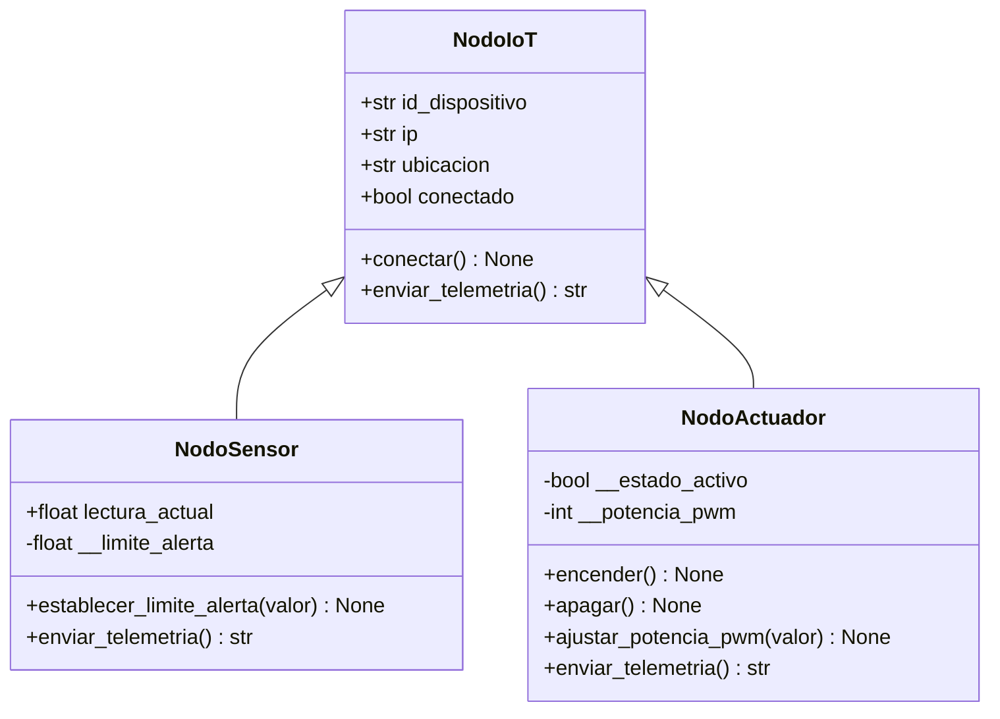

Práctica 2 — Bitácora de avances: semanas 1, 2 y 3
Sistema de Control Distribuido de Microclimas Agrícolas
Asignatura: Programación Orientada a Objetos  
Lenguaje: Python  
Modalidad: Simulación de nodos IoT en software, sin montaje físico con ESP32  
Inicio documentado: 14 de octubre de 2026  
Actualización del reporte: 3 de noviembre de 2026  
Fecha de entrega indicada: 7 de noviembre de 2026  
Estado: En desarrollo
Integrantes del equipo
Nombre	Matrícula	GitHub
Jose Maximiliano Hernandez Loeza	S23013991	`Maxloeza18`
Emmanuel Perez Viveros	S23013933	`Emma612-bit`
Daniel Isaac Izquierdo Hernandez	S23013986	`DaniLeft`
---
1. Introducción
La Práctica 2 consiste en reorganizar el sistema de sensores y actuadores de la práctica anterior para convertirlo en una red IoT simulada más fácil de ampliar y mantener. En esta nueva versión se utiliza programación orientada a objetos (POO): todos los dispositivos comparten una clase base y cada tipo de nodo agrega sus propias funciones.
El caso de aplicación elegido es el monitoreo y control de un microclima agrícola, como el de un invernadero. El sistema representa sensores de humedad del suelo, temperatura, humedad relativa e iluminación, así como actuadores de riego, ventilación y alumbrado. Estos componentes se comunican de manera lógica dentro de una simulación desarrollada en Python.
Este documento reúne los avances de tres semanas: primero, el análisis y diseño de las clases; después, la implementación reportada de la estructura en Python; y finalmente, la integración propuesta de la red con una vista de monitoreo y reglas de control por histéresis.
> **Nota sobre evidencias:** el equipo proporcionó una descripción de archivos de código implementados y una imagen del panel de monitoreo. No se adjuntaron los archivos `.py`, salidas de ejecución ni registros de pruebas. Por ello, las implementaciones se describen como *reportadas* y la imagen se utiliza como *referencia visual*, sin presentarla como prueba de funcionamiento verificado.
2. Objetivo general
Desarrollar una arquitectura modular de nodos IoT en Python, aplicando abstracción, herencia, encapsulamiento y polimorfismo, para simular la supervisión de sensores y el control de actuadores de un invernadero mediante telemetría y reglas de operación.
2.1 Objetivos específicos
Identificar los atributos y métodos comunes de los dispositivos IoT.
Definir una superclase `NodoIoT` y dos subclases: `NodoSensor` y `NodoActuador`.
Proteger información interna mediante atributos privados y métodos de validación.
Usar `enviar_telemetria()` de manera polimórfica en una lista mixta de dispositivos.
Representar la información de sensores y actuadores en una interfaz de supervisión.
Plantear reglas de encendido y apagado con histéresis para reducir cambios continuos de estado.
---
3. Semana 1 — Análisis y diseño de la arquitectura
Enfoque: comprender el problema, organizar las responsabilidades y proponer la estructura inicial del programa.
3.1 Actividades de la semana
Se analizaron los dispositivos necesarios para representar el funcionamiento de un invernadero. Los sensores obtienen valores simulados del ambiente y los actuadores modifican estados de operación. A partir de esto, se propuso una clase padre que concentre los datos compartidos por todos los nodos.
Clase	Función principal	Atributos y métodos previstos
`NodoIoT`	Identificar y conectar cualquier dispositivo de la red	`id_dispositivo`, `ip`, `ubicacion`, `conectado`, `conectar()`, `enviar_telemetria()`
`NodoSensor`	Representar las mediciones del ambiente	`lectura_actual`, `__limite_alerta`, validación del límite y telemetría especializada
`NodoActuador`	Representar acciones de control	`__estado_activo`, `__potencia_pwm`, `encender()`, `apagar()` y telemetría especializada
Se determinó que las clases hijas utilizarían `super()` para inicializar los datos heredados y que cada una sobrescribiría `enviar_telemetria()` para generar mensajes acordes con su función.
3.2 Diagrama de clases propuesto

Los signos `+` y `-` representan, respectivamente, miembros públicos y privados. El diagrama muestra una propuesta de diseño y debe contrastarse con el código definitivo antes de incorporarlo al reporte final.
3.3 Resultado de la semana 1
Se dejó definida la responsabilidad de las tres clases, la relación de herencia y el comportamiento esperado del envío de telemetría. También se estableció la separación del código fuente y los documentos dentro del repositorio. Este resultado es de diseño, no una afirmación de pruebas funcionales ejecutadas.
---
4. Semana 2 — Implementación de clases y comportamiento polimórfico
Enfoque: transformar el diseño en archivos Python reutilizables.
4.1 Desarrollo reportado
De acuerdo con la bitácora proporcionada por el equipo, se avanzó en los siguientes módulos:
Archivo	Desarrollo reportado
`src/nodo_iot.py`	Superclase con identificación, IP, ubicación, estado de conexión y métodos comunes
`src/nodo_sensor.py`	Subclase con `super()`, límite de alerta privado, validación de valores y telemetría de sensores
`src/nodo_actuador.py`	Subclase con estado y potencia protegidos, métodos de encendido/apagado y telemetría de actuadores
`src/main.py`	Creación de nodos y recorrido de una colección mixta llamada `red_iot`
La organización anterior se presenta como implementación informada en el texto del equipo; para darla por comprobada se requiere revisar los archivos y ejecutar el programa.
4.2 Aplicación de los conceptos de POO
Abstracción. Los dispositivos tienen una identidad, una dirección lógica y una ubicación, por lo que estos datos se reúnen en `NodoIoT` sin importar si el objeto es sensor o actuador.
Herencia. `NodoSensor` y `NodoActuador` reciben los atributos comunes desde la clase padre. Así se evita repetir información en cada dispositivo.
Encapsulamiento. Los atributos `__limite_alerta`, `__estado_activo` y `__potencia_pwm` se manejan mediante métodos públicos controlados. Los límites y rangos aceptados deben verificarse en las pruebas.
Polimorfismo. Los distintos nodos responden al mismo método `enviar_telemetria()`, pero cada subclase prepara un mensaje diferente.
4.3 Ejemplo del ciclo polimórfico
El siguiente fragmento ilustra la estructura esperada; no se presenta como una transcripción comprobada del código existente:
```python
# Ejemplo ilustrativo; supone que los nodos ya fueron creados.
red_iot = [sensor_suelo, sensor_ambiente, actuador_riego]

for nodo in red_iot:
    print(nodo.enviar_telemetria())
```
El programa recorre la lista sin utilizar `if/else` para identificar la clase de cada nodo. Cada objeto ejecuta su propia versión de `enviar_telemetria()`. Para que el ejemplo imprima los datos, se asume que el método devuelve una cadena de texto.
4.4 Validaciones previstas
En sensores, rechazar límites de alerta no numéricos, no finitos o fuera del rango definido para la magnitud simulada.
En actuadores, permitir cambios de estado a través de métodos públicos.
Si se adopta PWM de 8 bits, aceptar únicamente enteros de `0` a `255` para `__potencia_pwm`.
Comprobar que cada mensaje de telemetría identifique de forma clara el nodo y su lectura o estado.
4.5 Resultado de la semana 2
La bitácora del equipo reporta una estructura modular con clases especializadas, atributos protegidos y recorrido polimórfico. Queda pendiente adjuntar la ejecución real y registrar los resultados de los casos de prueba para confirmar el funcionamiento.
---
5. Semana 3 — Integración del sistema y propuesta de monitoreo
Enfoque: reunir las mediciones y estados de la red en una vista general y definir el comportamiento de control del invernadero.
5.1 Vista del sistema
La imagen proporcionada muestra un monitor de red IoT para un invernadero, dividido en secciones de nodos conectados, datos de sensores, estado de actuadores, lógica de control y telemetría recibida.

Figura 1. Imagen de referencia del panel de supervisión proporcionada para la bitácora. Los valores mostrados son ilustrativos y no equivalen, por sí solos, a mediciones ni pruebas verificadas del programa.
5.2 Dispositivos representados
ID	Tipo	Ubicación o función	Dirección lógica mostrada
`S001`	Sensor	Humedad del suelo	`192.168.1.51`
`S002`	Sensor	Temperatura, humedad relativa y luminosidad	`192.168.1.52`
`A001`	Actuador	Electroválvula de riego	`192.168.1.61`
`A002`	Actuador	Ventilador extractor	`192.168.1.62`
`A003`	Actuador	Iluminación	`192.168.1.63`
Las direcciones IP funcionan como identificadores simulados en el contexto de esta práctica; no se afirma que existan dispositivos físicos conectados a esas direcciones.
5.3 Variables y estados observados en la imagen
Elemento	Valor visible en la referencia	Interpretación
Humedad del suelo	`68 %`	Lectura simulada para decidir el riego
Temperatura ambiente	`24.5 °C`	Variable para supervisar la ventilación
Humedad relativa del aire	`72 %`	Condición ambiental adicional
Intensidad lumínica	`320 lux`	Información para evaluar el alumbrado
Electroválvula de riego	`ON`	Riego activado en la referencia
Ventilador extractor	`ON`, PWM `75 %`	Ventilación con potencia regulada
Iluminación	`OFF`	Alumbrado apagado en la referencia
Los números y estados anteriores se extrajeron de la imagen. No se deben tratar como resultados experimentales mientras no estén respaldados por registros reales de la simulación.
5.4 Lógica de control con histéresis
La histéresis utiliza dos umbrales distintos para evitar que un actuador se encienda y apague constantemente cuando una medición oscila alrededor de un único límite.
Ejemplo de riego para humedad del suelo:
Si la humedad es menor o igual a 60 %, activar el riego.
Si la humedad es mayor o igual a 75 %, desactivar el riego.
Si la humedad permanece entre 60 % y 75 %, conservar el estado anterior de la válvula.
Así, un valor de 68 % con la válvula encendida es coherente si el riego se activó antes al bajar la humedad al umbral inferior. Sin conocer el estado previo, no es posible deducir la decisión únicamente a partir del 68 %.
Para ventilación: la variable de referencia es la temperatura en grados Celsius, por lo que sus umbrales deben expresarse en °C, no en porcentajes de humedad. Se propone encender al superar una temperatura alta `T_alta`, apagar al bajar de `T_baja` y conservar el estado entre ambas, con `T_alta > T_baja`. Los valores de temperatura concretos deben definirse al configurar la simulación.
El porcentaje PWM 75 % corresponde a la regulación del ventilador y es diferente de los umbrales de temperatura. Si se utiliza PWM de 8 bits, el 75 % equivale aproximadamente a un valor de 191 sobre 255; esta equivalencia es un cálculo de referencia, no un parámetro confirmado del código.
5.5 Telemetría y presentación de datos
La sección inferior del panel agrupa mensajes que identifican el dispositivo, la lectura o acción y la hora del evento. En una implementación comprobable, cada registro deberá mostrar como mínimo:
Identificador único del nodo.
Lectura o estado reportado y sus unidades, cuando correspondan.
Fecha u hora generada por la simulación.
Estado de conexión, si el sistema utiliza esa propiedad.
La consola HMI puede ser la interfaz funcional requerida para la práctica. La imagen sirve como referencia para una posible presentación gráfica, pero no es necesario afirmar que se ha programado un panel gráfico si solamente existe su diseño.
5.6 Observaciones para corregir el panel antes de la entrega
En la imagen de referencia hay aspectos que conviene revisar para que la demostración sea coherente:
El bloque de ventilación utiliza el término temperatura, pero muestra límites de `60 %` y `75 %`. Si el control se basa en temperatura, estos umbrales deben convertirse en valores configurados en °C.
El panel muestra la iluminación apagada (`A003`, `OFF`), mientras que una línea del registro inferior parece indicar iluminación encendida. Si ambos datos corresponden al mismo instante, se debe corregir la discrepancia; si corresponden a instantes distintos, las horas deben permitir distinguirlos.
El estado de riego al `68 %` de humedad debe validarse considerando la memoria del estado anterior, ya que se encuentra entre los dos límites de histéresis.
Estos puntos se anotan como revisión de consistencia del diseño visual, no como errores comprobados en el código Python.
5.7 Resultado de la semana 3
Quedó documentada la composición de la red de microclimas agrícolas, sus variables principales y una propuesta de visualización. También se explicaron las reglas de control por histéresis que deberá seguir el sistema. La integración funcional, la consistencia de los estados y la generación efectiva de mensajes requieren pruebas y capturas de ejecución.
---
6. Estructura de archivos de la práctica
```text
practica-02/
├── src/
│   ├── nodo_iot.py
│   ├── nodo_sensor.py
│   ├── nodo_actuador.py
│   └── main.py
└── docs/
    ├── Bitacora_Avances_Practica_02_Semanas_01_02_03.md
    ├── Reporte_Evidencias_P2.pdf       # Entregable final pendiente
    └── evidencias/
        ├── referencia_monitor_iot.png  # Imagen proporcionada
        └── ...                          # Capturas reales por agregar
```
Los archivos `.py` se enumeran conforme al avance descrito por el equipo. Su existencia y contenido deben comprobarse en el repositorio antes de cerrar la entrega.
7. Seguimiento de avances y evidencias
Elemento	Semana	Situación según la información proporcionada	Evidencia por completar
Arquitectura con `NodoIoT`	1	Diseño documentado	Comparación con código fuente
Diagrama UML	1	Propuesta incluida	Exportación legible al PDF
Herencia y uso de `super()`	2	Implementación reportada	Código revisado
Encapsulamiento y validaciones	2	Implementación reportada	Pruebas de entradas válidas e inválidas
Sobrescritura de telemetría	2	Implementación reportada	Salida real del programa
Bucle polimórfico	2	Implementación reportada	Captura de consola
Monitor del invernadero	3	Referencia visual proporcionada	Aclarar si es diseño o interfaz ejecutable
Control con histéresis	3	Reglas documentadas	Pruebas de cruce de umbrales y memoria de estado
Video demostrativo	Entrega	No proporcionado	Enlace público, máximo 3 minutos
Reporte PDF	Entrega	No proporcionado	`docs/Reporte_Evidencias_P2.pdf`
7.1 Casos de prueba recomendados
Prueba	Acción	Resultado esperado
Herencia	Crear un sensor y un actuador	Ambos comparten atributos base de `NodoIoT`
Validación del sensor	Intentar asignar un límite fuera de rango	Se rechaza el valor de manera controlada
Control de PWM	Probar `0`, `255` y un valor inválido	Se aceptan los extremos válidos y se rechaza el inválido
Polimorfismo	Recorrer `red_iot` y llamar `enviar_telemetria()`	Cada objeto devuelve información específica sin detectar su tipo
Riego por histéresis	Simular 59 %, luego 68 % y finalmente 76 %	La válvula enciende, conserva el encendido y después apaga
Ventilación por histéresis	Cruzar umbrales configurados en °C	El ventilador cambia de estado sólo en los límites definidos
Registro de eventos	Generar distintas lecturas y estados	Los mensajes muestran ID, valor/estado y hora consistente
Estado de las pruebas: pendientes de documentar con evidencia verificable. La tabla contiene resultados esperados, no resultados que ya se hayan observado.
8. Actividades pendientes para la entrega
[ ] Revisar el código completo para confirmar la correspondencia con el UML.
[ ] Ejecutar el programa y documentar los resultados del ciclo polimórfico.
[ ] Comprobar las validaciones de límites, estados y PWM.
[ ] Definir y probar umbrales de ventilación expresados en °C.
[ ] Verificar la coherencia entre datos de sensores, estados de actuadores y telemetría.
[ ] Capturar la consola HMI en funcionamiento.
[ ] Aclarar si el panel visual es una maqueta, un diseño o una interfaz funcional.
[ ] Exportar el UML a imagen e incluirlo en el reporte final.
[ ] Grabar el video demostrativo de máximo 3 minutos y comprobar que su enlace sea público.
[ ] Generar y revisar `practica-02/docs/Reporte_Evidencias_P2.pdf`.
9. Conclusión general
Durante las primeras tres semanas se ha descrito el paso de un conjunto de dispositivos simulados a una arquitectura IoT más organizada. La Semana 1 se centró en analizar el problema y diseñar una jerarquía de clases; la Semana 2 reunió el desarrollo en Python reportado por el equipo, aplicando herencia, encapsulamiento y polimorfismo; y la Semana 3 permitió definir cómo representar la red de un invernadero y cómo aplicar reglas de control con histéresis.
El proyecto muestra una aplicación práctica de la programación orientada a objetos: los dispositivos comparten una estructura común, pero mantienen comportamientos propios. Como siguiente paso, será indispensable respaldar el avance con ejecución real, pruebas de validación y evidencias claras, para que la documentación final refleje con precisión lo que el software efectivamente realiza.
---
Documento: Bitácora de avances — Práctica 2, semanas 1, 2 y 3.  
Nota: la imagen del monitor se utiliza como referencia visual y no sustituye las capturas de ejecución requeridas.
