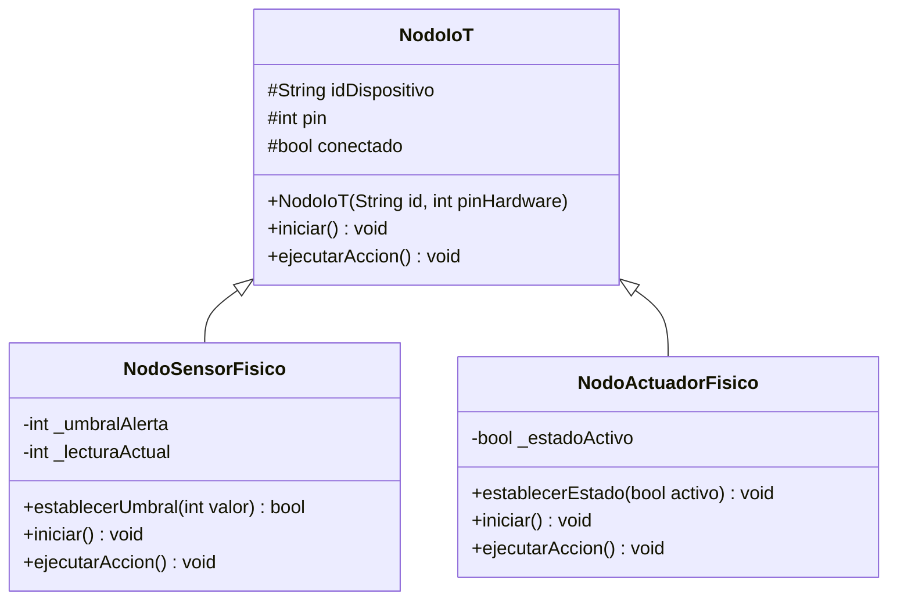

# Práctica 3 — Avance de desarrollo, Semana 1

## Implementación Física de Nodos IoT Heterogéneos en C++ (ESP32)

**Asignatura:** Programación Orientada a Objetos  
**Fecha de actualización:** 09 de noviembre de 2026  
**Etapa:** Semana 1 — análisis, diseño y preparación de la implementación  
**Lenguaje y plataforma:** C++ para ESP32 (Arduino IDE o PlatformIO)  
**Estado:** Diseño preliminar documentado; código compilado y montaje físico pendientes de verificar

---

## 1. Introducción

En la Práctica 2 se diseñó y simuló en Python una arquitectura de nodos IoT mediante una clase base y subclases especializadas para sensores y actuadores. La Práctica 3 retoma ese enfoque y lo traslada a un **ESP32 programado en C++**, de modo que las lecturas y las acciones correspondan a componentes electrónicos reales.

El reto consiste en conservar los principios de **herencia, encapsulamiento y polimorfismo**, adaptándolos al funcionamiento del microcontrolador. Para ello, se propone una clase padre `NodoIoT`, dos clases derivadas (`NodoSensorFisico` y `NodoActuadorFisico`) y un arreglo de punteros a la clase base que permita ejecutar las acciones de cada dispositivo desde el ciclo principal de Arduino.

**Alcance de este avance:** se documentan la estructura propuesta del programa, la selección preliminar del circuito, los criterios de validación y el plan de pruebas. **No se presentan todavía como realizados** la compilación del programa, el montaje del ESP32, las mediciones del sensor ni la grabación de una demostración.

## 2. Objetivo de la Semana 1

Definir la arquitectura de software y el esquema inicial de conexión para construir una red IoT heterogénea en un ESP32, aplicando los mismos principios de programación orientada a objetos utilizados en Python, pero mediante clases, métodos virtuales y dispositivos físicos en C++.

**Resultados documentados en esta etapa:**

- Identificación de las responsabilidades de la superclase y de sus subclases.
- Propuesta de atributos encapsulados y validación del umbral del sensor.
- Selección preliminar de una entrada analógica y una salida digital.
- Diseño del arreglo polimórfico que se recorrerá desde `setup()` y `loop()`.
- Definición de evidencias y pruebas necesarias para la entrega final.

## 3. Análisis y diseño de clases

### 3.1 Superclase `NodoIoT`

La clase `NodoIoT` reunirá los elementos compartidos por todos los dispositivos: `idDispositivo`, `pin` y `conectado`. Su constructor recibirá el identificador y el pin físico; los métodos virtuales `iniciar()` y `ejecutarAccion()` permitirán que cada subclase defina su comportamiento.

| Elemento | Función prevista |
|---|---|
| `idDispositivo` | Identificar el nodo en los mensajes del monitor serie. |
| `pin` | Almacenar el GPIO que utilizará el dispositivo. |
| `conectado` | Representar el estado lógico de inicialización o disponibilidad del nodo. |
| `iniciar()` | Configurar el hardware mediante `pinMode()` y otras instrucciones necesarias. |
| `ejecutarAccion()` | Ejecutar la lectura o actuación específica de cada nodo. |

En C++, la reutilización del constructor padre se hará con una **lista de inicialización** (por ejemplo, `NodoIoT(id, pinHardware)`); a diferencia de Python, no se utiliza `super()`.

### 3.2 Subclase `NodoSensorFisico`

Esta clase representará un sensor conectado al ESP32. En la propuesta inicial se utilizará un elemento analógico, como un **potenciómetro o un LDR con divisor de tensión**, para facilitar la comprobación de cambios de lectura.

El atributo privado `_umbralAlerta` se modificará mediante un método público de validación. Para una resolución ADC configurada a 12 bits, el umbral se establecerá dentro de **0 a 4095**. En `ejecutarAccion()`, el sensor realizará la lectura mediante `analogRead(pin)` y la reportará por el monitor serie, incluyendo una advertencia cuando se supere el umbral.

### 3.3 Subclase `NodoActuadorFisico`

La clase `NodoActuadorFisico` representará una salida del ESP32. Para las primeras pruebas se propone un **LED con resistencia limitadora**, ya que permite visualizar claramente la activación y desactivación sin requerir un controlador de potencia externo.

Su atributo privado `_estadoActivo` controlará el estado lógico. En `iniciar()` se configurará el GPIO como salida; en `ejecutarAccion()` se aplicará el estado con `digitalWrite()`. El control PWM podría incorporarse después, si se elige un actuador que lo requiera y se confirma la API correspondiente a la versión de Arduino-ESP32 utilizada.

### 3.4 Propuesta de diagrama UML



El diagrama es **preliminar** y deberá ajustarse a los nombres y firmas que finalmente se utilicen en el código.

## 4. Propuesta de conexión física

Para realizar una prueba mínima de entrada y salida se plantea el siguiente montaje:

| Componente | Conexión propuesta | Propósito |
|---|---|---|
| ESP32 | Alimentación mediante USB | Ejecutar el programa C++ y comunicar datos por serie. |
| Potenciómetro o LDR con divisor de tensión | GPIO 34 (ADC, en ESP32 clásico) | Obtener una lectura analógica variable. |
| LED con resistencia de 220 a 330 Ω | GPIO 23 y GND | Representar la actuación digital. |
| Protoboard y cables | Según el esquema definitivo | Montar y modificar fácilmente el circuito. |

**Precauciones de diseño:** verificar que la placa utilizada tenga disponibles esos GPIO; el pin GPIO 34 es solo de entrada en el ESP32 clásico. La señal analógica debe permanecer dentro del rango eléctrico admitido por el ESP32 (habitualmente hasta 3.3 V, según la placa y su configuración). No se conectarán motores, relés sin interfaz de manejo ni otras cargas de potencia directamente a un GPIO.

En el reporte final se incorporará un **esquema de conexiones** y fotografías propias del circuito montado.

## 5. Diseño del polimorfismo en `setup()` y `loop()`

La solución central consiste en declarar los dispositivos como objetos concretos, almacenar sus direcciones en un arreglo de punteros `NodoIoT*` e invocar los métodos virtuales a través de ese arreglo.

**Ejemplo conceptual para la siguiente etapa (no verificado aún en hardware):**

```cpp
// Fragmento ilustrativo: se asume que las clases ya están definidas.
NodoSensorFisico sensor("SENS_ANALOG", 34);
NodoActuadorFisico actuador("ACT_LED", 23);
NodoIoT* red[] = { &sensor, &actuador };
const size_t totalNodos = sizeof(red) / sizeof(red[0]);

void setup() {
    Serial.begin(115200);
    for (size_t i = 0; i < totalNodos; ++i) {
        red[i]->iniciar();
    }
}

void loop() {
    for (size_t i = 0; i < totalNodos; ++i) {
        red[i]->ejecutarAccion();
    }
    delay(500);
}
```

La instrucción `red[i]->ejecutarAccion()` enviará la llamada a la implementación correspondiente al tipo real del objeto. **No se requieren comparaciones de tipo con `if/else` para elegir entre sensor y actuador**. Las condiciones internas necesarias para comparar una lectura con el umbral siguen siendo válidas.

El ejemplo utiliza objetos de duración estática y sus direcciones; no necesita `new` ni asignación dinámica para este montaje reducido.

## 6. Organización prevista del repositorio

```text
repositorio/
├── .gitignore
├── AUTHORS.md
└── practica-03/
    ├── src/
    │   ├── NodoIoT.h
    │   ├── NodoSensorFisico.h
    │   ├── NodoActuadorFisico.h
    │   └── practica_03.ino
    └── docs/
        ├── Avance_Semana_01_Practica_03.md
        ├── Reporte_Evidencias_P3.pdf       # Entregable final
        └── evidencias/                     # Esquema, fotos y capturas reales
```

Los nombres de los archivos fuente se presentan como una propuesta organizativa y pueden ajustarse al crear el proyecto. El archivo PDF final y las evidencias todavía son elementos pendientes.

## 7. Matriz de avances y validaciones pendientes

| Requisito | Estado de la Semana 1 | Evidencia prevista |
|---|---|---|
| Migración conceptual de Python a C++ | Diseño documentado | Comparación de arquitectura y código C++. |
| Herencia entre `NodoIoT` y subclases | Estructura UML propuesta | Clases y constructores implementados. |
| Encapsulamiento de umbral y estado | Validaciones definidas a nivel de diseño | Pruebas con valores válidos e inválidos. |
| Métodos virtuales y polimorfismo | Bucle de ejemplo documentado | Ejecución real del arreglo `NodoIoT*`. |
| Sensor físico con `analogRead()` | Sensor y GPIO propuestos | Lecturas reales en monitor serie. |
| Actuador físico con `digitalWrite()` | LED y GPIO propuestos | Encendido y apagado observables. |
| Monitor serie a 115200 baudios | Configuración incluida en ejemplo | Captura auténtica de la salida serie. |
| Montaje en protoboard | Pendiente | Fotografías propias y esquema eléctrico. |
| Video demostrativo (máx. 3 min) | Pendiente | Enlace público comprobado. |
| Reporte final PDF | Pendiente | `practica-03/docs/Reporte_Evidencias_P3.pdf`. |

## 8. Actividades para la Semana 2

1. Crear las clases `NodoIoT`, `NodoSensorFisico` y `NodoActuadorFisico` en C++.
2. Implementar la lista de inicialización del constructor y los métodos virtuales.
3. Incorporar el *setter* del umbral de 0 a 4095 y comprobar sus validaciones.
4. Compilar el programa para el modelo específico de ESP32 disponible.
5. Montar el sensor y el LED en protoboard, revisando antes las conexiones y los niveles de voltaje.
6. Abrir el monitor serie a 115200 baudios y verificar que se impriman las lecturas y estados.
7. Confirmar que el `loop()` ejecuta cada nodo desde el arreglo de punteros a la clase base.
8. Registrar fotografías, capturas y observaciones de pruebas reales.

## 9. Conclusión preliminar

El avance de la Semana 1 establece una ruta clara para trasladar la arquitectura de nodos IoT de Python a C++ y conectarla con hardware real. El uso de una superclase `NodoIoT`, subclases especializadas y métodos virtuales permitirá mantener una estructura modular, mientras que el arreglo de punteros facilitará el tratamiento uniforme de sensores y actuadores desde el programa principal.

La siguiente etapa consistirá en **implementar y compilar** la propuesta, realizar el montaje físico en el ESP32 y reunir evidencias reales de su funcionamiento. Con esas pruebas se podrá completar posteriormente el reporte `Reporte_Evidencias_P3.pdf`.

---

**Nota de documentación:** este archivo es un avance de análisis y diseño, no un reporte de resultados físicos. Las marcas de cumplimiento deberán actualizarse únicamente cuando existan código compilado, mediciones, fotografías o video verificables.
