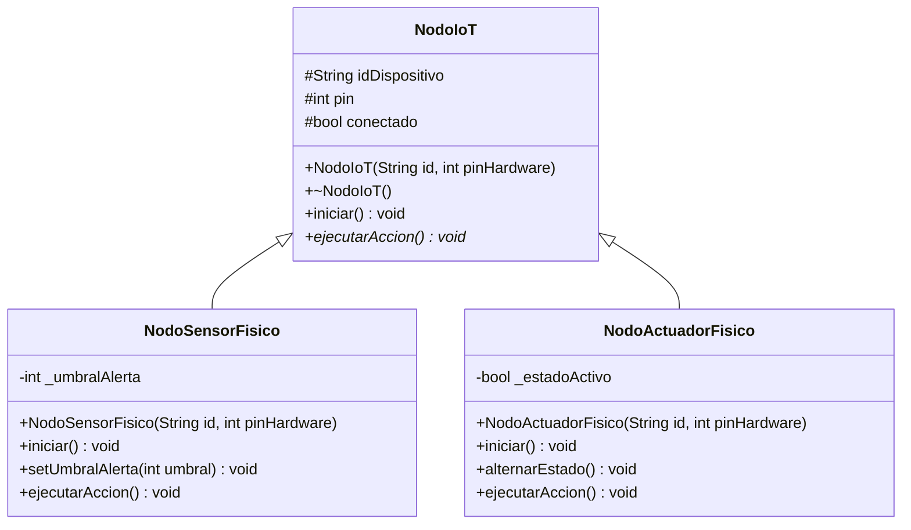

# Avance de la Semana 1 — Práctica 3
## Implementación Física de Nodos IoT Heterogéneos en C++ (ESP32)

**Asignatura:** Programación Orientada a Objetos  
**Documento:** Reporte de avance semanal  
**Corte de actualización:** 11 de noviembre de 2026  
**Estado:** Segundo avance incorporado; pruebas físicas pendientes

---

## 1. Introducción

La Práctica 3 tiene como propósito trasladar al entorno físico del microcontrolador ESP32 los principios de programación orientada a objetos trabajados previamente mediante simulaciones. En esta ocasión, la arquitectura se desarrolla en C++ y se orienta a representar dispositivos con distintas funciones, principalmente sensores y actuadores.

Durante la primera semana se ha trabajado en dos etapas. La primera consistió en definir la organización del programa y las responsabilidades de las clases; la segunda permitió trasladar ese diseño a archivos de cabecera que ya contienen las primeras implementaciones. El objetivo es mantener una estructura que pueda ampliarse sin repetir el código común a cada dispositivo.

Este documento registra **lo planeado y lo implementado hasta el segundo avance**, distinguiendo el trabajo de programación de las pruebas con hardware, que todavía no se han acreditado.

## 2. Objetivo de la semana

Diseñar e implementar la estructura inicial de clases para un sistema de nodos IoT físicos basado en ESP32, utilizando **abstracción, herencia, encapsulamiento y polimorfismo**, de manera que sensores y actuadores compartan una interfaz común, pero ejecuten operaciones diferentes según el tipo de dispositivo.

### Objetivos específicos

- Definir la superclase `NodoIoT`, encargada de concentrar los atributos y comportamientos comunes.
- Establecer clases derivadas para sensores y actuadores.
- Proteger los parámetros internos que requieran validación.
- Preparar métodos para configurar los pines y ejecutar acciones sobre el hardware.
- Documentar los avances y dejar identificadas las pruebas que deben realizarse posteriormente.

## 3. Desarrollo de la Semana 1

### 3.1 Primer avance — Análisis y diseño de la arquitectura

En la primera etapa se definió una arquitectura jerárquica en la que los dispositivos comparten datos básicos, como un identificador, un pin de conexión y un indicador de inicialización. La idea principal fue evitar que cada sensor o actuador tuviera que declarar nuevamente estos elementos.

Se plantearon tres responsabilidades:

| Clase | Función dentro del sistema | Comportamiento previsto |
|---|---|---|
| `NodoIoT` | Servir como base de todos los dispositivos. | Conservar los atributos compartidos y establecer métodos virtuales. |
| `NodoSensorFisico` | Representar un dispositivo de entrada. | Configurar un pin como entrada, adquirir una lectura y verificar un umbral. |
| `NodoActuadorFisico` | Representar un dispositivo de salida. | Configurar un pin como salida y modificar su estado lógico. |

Desde el diseño se consideró que la clase padre debía permitir el uso de **polimorfismo**. Esto significa que un programa principal podrá trabajar con distintos nodos a través de una misma interfaz, aunque cada clase resuelva internamente su operación de una manera particular.

También se contempló una separación entre el código compartido y el específico del hardware, mediante archivos de cabecera de C++. En esta fase, la selección definitiva de pines y el montaje físico quedaron como actividades posteriores.

### 3.2 Segundo avance — Implementación de la superclase `NodoIoT`

El segundo avance aporta el archivo `NodoIoT.h`, que contiene la primera implementación de la clase padre. En lugar de permanecer como una propuesta de diseño, sus atributos y métodos ya están declarados en C++ y utilizan el entorno Arduino mediante `#include <Arduino.h>`.

**Elementos implementados:**

- `idDispositivo` (`String`): nombre o identificador del nodo.
- `pin` (`int`): referencia al pin físico utilizado por el dispositivo.
- `conectado` (`bool`): indicador de estado inicializado en `false`.
- Constructor `NodoIoT(String id, int pinHardware)`: recibe y asigna los datos iniciales.
- Destructor virtual `~NodoIoT()`: permite la destrucción adecuada de objetos derivados mediante punteros a la clase base.
- Método virtual `iniciar()`: deja abierta la configuración que realizará cada subclase.
- Método virtual puro `ejecutarAccion() = 0`: obliga a las clases concretas a definir su comportamiento.

La declaración de `ejecutarAccion()` como método virtual puro convierte a `NodoIoT` en una **clase abstracta**. Por ello, el código está pensado para crear objetos de las clases derivadas y no objetos genéricos de `NodoIoT`.

Los atributos se declararon como `protected`, por lo que pueden utilizarse desde las clases hijas sin exponerlos como miembros públicos.

> **Aclaración:** aunque el atributo se llama `conectado`, en el código recibido se emplea como indicador de inicialización. No existe todavía una implementación de conexión Wi-Fi o comunicación de red.

### 3.3 Segundo avance — Implementación de `NodosFisicos.h`

El archivo `NodosFisicos.h` incorpora dos clases derivadas, ambas con herencia pública de `NodoIoT`. Con esto se pasa de una estructura abstracta a comportamientos específicos que hacen uso de las funciones del ESP32.

#### 3.3.1 Clase `NodoSensorFisico`

Esta clase representa un nodo que obtiene información mediante una entrada analógica. Su constructor invoca el constructor de `NodoIoT` y establece un umbral de alerta inicial de **2048**.

En el método `iniciar()` se configura el pin mediante `pinMode(pin, INPUT)` y se actualiza el indicador `conectado` a `true`.

El atributo `_umbralAlerta` es privado. Para modificarlo se agregó `setUmbralAlerta(int umbral)`, que acepta valores entre **0 y 4095**. Si se proporciona un valor fuera del intervalo, se imprime un mensaje de error por el monitor serie y el umbral permanece sin cambios.

Por su parte, `ejecutarAccion()` realiza las siguientes operaciones:

1. Lee la entrada mediante `analogRead(pin)`.
2. Muestra el identificador del dispositivo y la lectura ADC en el monitor serie.
3. Compara la lectura con el umbral almacenado.
4. Si la lectura **supera** el umbral, agrega el mensaje de alerta correspondiente.

Esto permite observar tanto la lectura como una condición básica de advertencia. El código todavía no convierte los valores ADC a unidades físicas, como grados Celsius o porcentaje de humedad; dicha conversión dependerá del sensor que se conecte.

#### 3.3.2 Clase `NodoActuadorFisico`

La clase `NodoActuadorFisico` representa un dispositivo de salida, como un relé o una etapa de control de encendido y apagado.

Se agregó el atributo privado `_estadoActivo`, que se inicializa en `false`. Su método `iniciar()` configura el pin como `OUTPUT`, escribe `LOW` para comenzar apagado y marca el nodo como inicializado.

Se implementaron dos acciones principales:

- `alternarEstado()`: invierte el valor lógico de `_estadoActivo`.
- `ejecutarAccion()`: escribe `HIGH` o `LOW` en el pin mediante `digitalWrite()` y muestra el resultado por el monitor serie.

Es importante observar que `alternarEstado()` **solo cambia el estado interno**. La salida física se actualiza después, cuando se ejecuta `ejecutarAccion()`.

Esta implementación ofrece un control digital básico; aún no incorpora modulación PWM ni una lógica automática de respuesta a las lecturas de los sensores.

### 3.4 Aplicación de los conceptos de POO

| Concepto | Aplicación dentro del código |
|---|---|
| **Abstracción** | `NodoIoT` establece las características comunes y declara una operación que cada dispositivo debe implementar. |
| **Herencia** | `NodoSensorFisico` y `NodoActuadorFisico` derivan de `NodoIoT` mediante `public NodoIoT`. |
| **Encapsulamiento** | `_umbralAlerta` y `_estadoActivo` son privados; el umbral se modifica mediante un método que valida su intervalo. |
| **Polimorfismo** | Ambas clases sobrescriben `iniciar()` y `ejecutarAccion()` con operaciones propias de entrada o salida. |

El polimorfismo ya está definido en las clases, pero **su utilización desde un programa principal con una colección heterogénea de objetos aún no se ha mostrado** en los archivos entregados.

### 3.5 Diagrama UML actualizado conforme al código

El siguiente diagrama refleja los miembros principales presentes en los dos archivos de cabecera, no únicamente la propuesta inicial.



**Notación:** `+` público; `#` protegido; `-` privado; `*` método virtual puro.

### 3.6 Organización del código desarrollada

Los archivos recibidos para este avance son:

```text
include/
├── NodoIoT.h          # Superclase abstracta
└── NodosFisicos.h     # Clases de sensor y actuador
```

Se utilizan guardas de inclusión (`#ifndef`, `#define` y `#endif`) para evitar definiciones duplicadas. Además, `NodosFisicos.h` incluye `NodoIoT.h`, lo que permite utilizar la clase padre al declarar las dos subclases.

La carpeta `include/` es la ubicación indicada por la documentación de desarrollo. La estructura completa del proyecto y su archivo principal deberán verificarse al integrarlo.

## 4. Resultados registrados hasta el segundo avance

Al concluir esta etapa documental se cuenta con:

1. Una arquitectura de tres clases organizada mediante herencia.
2. La definición funcional de una clase abstracta con destructor virtual y método virtual puro.
3. Dos clases derivadas que sobrescriben los métodos de la clase base.
4. Validación de un umbral ADC en el nodo sensor.
5. Lectura analógica y control de una salida digital escritos en C++.
6. Mensajes de diagnóstico previstos para el monitor serie.
7. Un diagrama UML actualizado para representar el código efectivamente proporcionado.

Estos resultados corresponden a **funcionalidades presentes en el código fuente**. No equivalen todavía a confirmar su funcionamiento sobre una tarjeta ESP32 real.

## 5. Actividades pendientes para los siguientes avances

- Integrar las clases en un archivo principal que cree objetos de sensores y actuadores.
- Comprobar una ejecución polimórfica mediante referencias o punteros a `NodoIoT`.
- Seleccionar y documentar los GPIO adecuados para el hardware que se utilizará.
- Compilar el proyecto con el entorno de desarrollo elegido.
- Realizar el montaje y las pruebas físicas con el ESP32.
- Validar lecturas y mensajes del monitor serie; registrar evidencias con resultados reales.
- Comprobar valores límite del umbral y verificar el funcionamiento del actuador.

No se registran como completadas la compilación, la carga de firmware, la comunicación por red ni las pruebas físicas, porque los archivos proporcionados no contienen esas evidencias.

## 6. Conclusión de la Semana 1 (segundo avance)

Durante la primera semana, el trabajo pasó de la planeación de una jerarquía de nodos IoT a la implementación de sus primeras clases en C++. Se estableció una superclase abstracta que concentra la identidad y la estructura básica de los dispositivos, y se desarrollaron dos subclases para representar las operaciones propias de sensores y actuadores.

La principal aportación de este segundo avance es que los conceptos de programación orientada a objetos ya se observan directamente en el código: la herencia evita repetir atributos, el encapsulamiento controla el acceso a parámetros internos y el polimorfismo permite definir acciones distintas bajo una interfaz compartida.

La siguiente etapa deberá comprobar que estas clases se integran correctamente en un programa principal y que las acciones previstas funcionan con el hardware. De esta manera se podrán complementar los avances de diseño y programación con evidencias de compilación, montaje y ejecución.

---

**Archivos utilizados para esta actualización:** `NodoIoT.h`, `NodosFisicos.h` e `instrucciones.md`.  
**Tipo de actualización:** incorporación del segundo avance al reporte semanal; no se modificó el código fuente.
