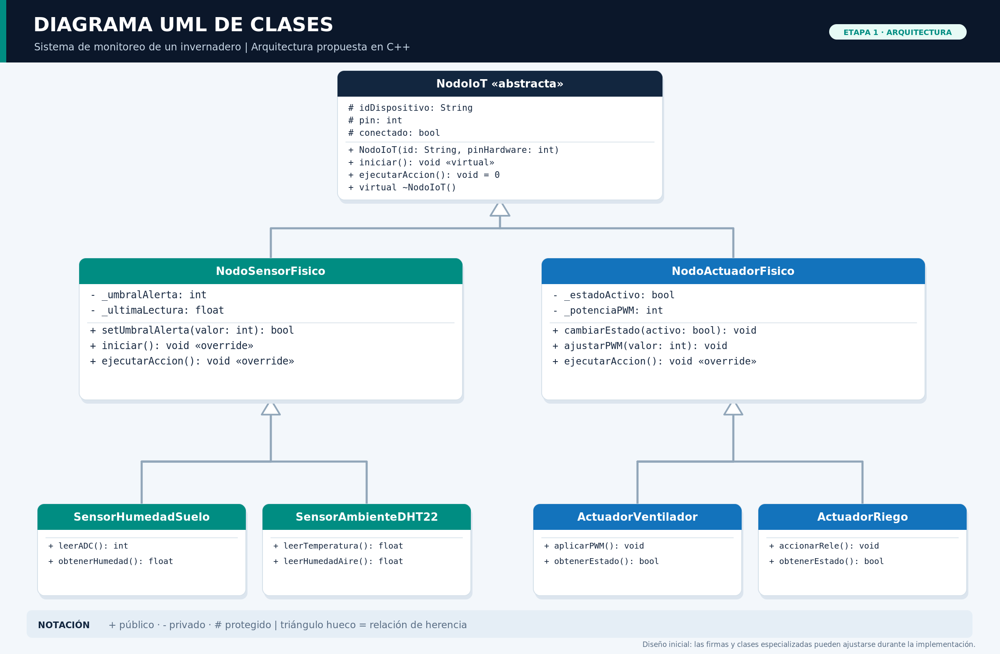
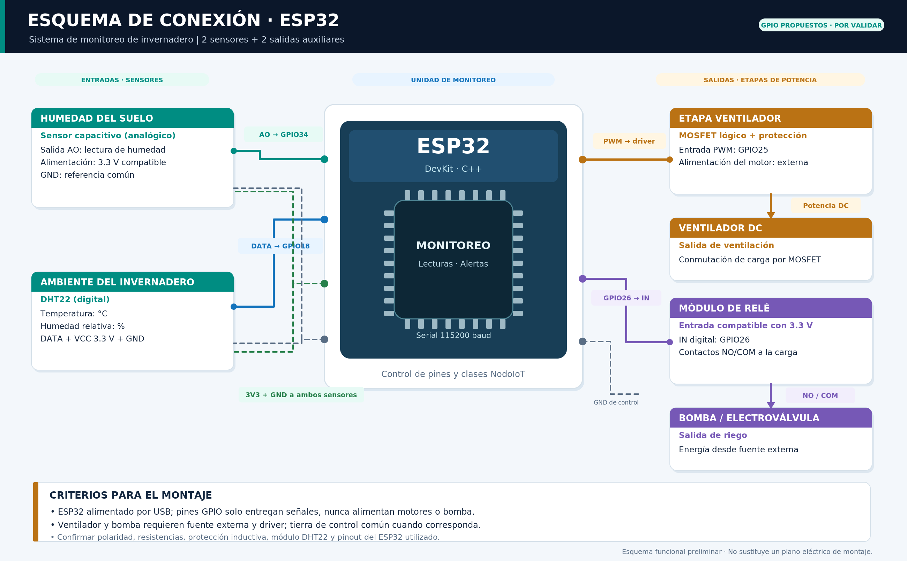

# 🌱 Sistema de Monitoreo de Invernadero con ESP32

**Propuesta de proyecto | Equipo 7 | Programación Orientada a Objetos**

> **Estado:** Etapa 1 — planteamiento y diseño de arquitectura. El proyecto se encuentra en fase de propuesta; los componentes, conexiones y comportamientos descritos aún deben implementarse y validarse físicamente.

## 📖 Descripción del proyecto

Se propone desarrollar un **sistema de monitoreo de las condiciones de un invernadero** utilizando un microcontrolador **ESP32**, sensores ambientales y una arquitectura de software orientada a objetos en **C++**.

El sistema estará diseñado para obtener mediciones de **temperatura ambiental**, **humedad relativa del aire** y **humedad del suelo**. Estas lecturas permitirán identificar condiciones que requieran atención y emitir avisos a través del monitor serie. Como apoyo al monitoreo, se contemplan dos salidas: un **ventilador** y un **sistema de riego**.

La propuesta prioriza la **supervisión y visualización de datos**. La activación de los actuadores se considera una función complementaria que podrá incorporarse de manera controlada en etapas posteriores.

## 🎯 Objetivo general

Diseñar un sistema modular de monitoreo para un invernadero, basado en ESP32 y C++, que permita adquirir y consultar datos de las condiciones ambientales y del suelo, identificar valores fuera de los rangos configurados y contemplar acciones auxiliares de ventilación y riego mediante principios de programación orientada a objetos.

### Objetivos específicos

1. Definir al menos **dos entradas de sensores** y **dos salidas de actuación** apropiadas para un invernadero.
2. Diseñar las clases del programa aplicando **herencia, encapsulamiento y polimorfismo**.
3. Representar la arquitectura mediante un **diagrama UML** y un **esquema de conexiones**.
4. Establecer cómo se obtendrán, mostrarán y evaluarán las lecturas de los sensores.
5. Planificar las pruebas eléctricas y funcionales que se efectuarán durante el desarrollo.

## 🌿 Problema que busca resolver

En un invernadero pequeño, revisar manualmente las condiciones del ambiente y del sustrato puede dificultar la detección oportuna de cambios de temperatura, humedad del aire o humedad del suelo. Un sistema de monitoreo puede concentrar esas mediciones y facilitar el seguimiento del estado del cultivo.

Esta propuesta plantea una solución **modular, ampliable y de bajo costo relativo**, cuya primera versión podrá mostrar información por el **monitor serie a 115200 baudios**, sin depender inicialmente de una plataforma en la nube.

## 🔌 Hardware propuesto

| Tipo | Componente | Función | Conexión propuesta |
|---|---|---|---|
| Controlador | ESP32 DevKit | Procesamiento de lecturas y gestión de salidas | Unidad central |
| Entrada 1 | Sensor capacitivo de humedad del suelo | Obtener una lectura analógica del sustrato | Señal AO → **GPIO34 (ADC)** |
| Entrada 2 | DHT22 | Medir temperatura y humedad relativa del aire | Señal DATA → **GPIO18** |
| Salida 1 | Ventilador de corriente continua | Apoyar a la ventilación del invernadero | **GPIO25 (PWM)** → etapa de potencia con MOSFET |
| Salida 2 | Bomba de agua o electroválvula | Apoyar al sistema de riego | **GPIO26** → módulo de relé compatible |

**Material auxiliar previsto:** protoboard, cables, fuente de alimentación apropiada para las cargas, elementos de protección de las etapas de potencia y componentes de conexión necesarios.

**Nota de diseño:** los GPIO son preliminares. Se confirmarán con el modelo específico de ESP32, los módulos adquiridos y sus hojas de datos. El sensor del suelo deberá proporcionar una señal compatible con **3.3 V** en la entrada ADC. Los motores y la bomba **no se alimentarán directamente desde los pines del ESP32**.

## 🧠 Arquitectura de software propuesta

El programa se diseñará en **C++ para ESP32** mediante una clase base y clases especializadas:

- **`NodoIoT` (superclase abstracta):** contendrá la identidad del dispositivo, el pin asignado y su estado de inicialización; definirá los métodos virtuales `iniciar()` y `ejecutarAccion()`.
- **`NodoSensorFisico`:** representará el comportamiento común de los sensores e incorporará atributos privados y métodos de validación de umbrales.
- **`NodoActuadorFisico`:** representará el control de salidas y protegerá internamente el estado de los actuadores.
- **Clases especializadas propuestas:** `SensorHumedadSuelo`, `SensorAmbienteDHT22`, `ActuadorVentilador` y `ActuadorRiego`.

La **herencia** permitirá reutilizar la información común; el **encapsulamiento** limitará la modificación directa de valores internos; y el **polimorfismo** permitirá recorrer diferentes dispositivos mediante punteros a `NodoIoT` e invocar `ejecutarAccion()` sin identificar el tipo concreto con condiciones `if/else`.

La representación de estas clases es **preliminar**: sus firmas y métodos podrán ajustarse durante la implementación.

### Diagrama UML de clases



[Ver imagen UML en tamaño completo](diagrams/uml_clases_inicial.png)

### Esquema de conexiones



[Ver esquema de conexiones en tamaño completo](diagrams/esquematico_conexion.png)

El esquema presenta la distribución funcional de las señales. **No sustituye un plano eléctrico definitivo**: antes del montaje deben verificarse tensiones, polaridades, corrientes, protección de cargas inductivas y compatibilidad de los módulos.

## ⚙️ Funcionamiento previsto

1. El ESP32 inicializará los sensores, las salidas y la comunicación serie.
2. El sistema leerá periódicamente la humedad del suelo y los datos ambientales del DHT22.
3. Las lecturas se mostrarán en el monitor serie, junto con la identificación del dispositivo y su estado.
4. Los valores se compararán con umbrales configurables para generar **alertas de monitoreo**.
5. Los módulos de ventilación y riego quedarán disponibles para pruebas controladas y posibles reglas de actuación posteriores.

Como mejora futura se contempla aplicar **histéresis** a las acciones automáticas para evitar encendidos y apagados repetitivos cerca de un umbral. Los límites definitivos dependerán del cultivo y de la calibración de los sensores; **no se consideran establecidos en esta etapa**.

## 🗂️ Organización del repositorio

```text
.
├── README.md
├── AUTHORS.md
├── .gitignore
└── diagrams/
    ├── uml_clases_inicial.png
    └── esquematico_conexion.png
```

En etapas posteriores podrán agregarse directorios como `src/` para el código C++ y `docs/` para el reporte técnico y las evidencias. La estructura mostrada arriba corresponde a los **archivos iniciales de la propuesta**.

## 🧪 Plan preliminar de validación

| Prueba prevista | Qué se verificará | Evidencia futura |
|---|---|---|
| Lectura del sensor de suelo | Respuesta ADC ante distintas condiciones del sustrato | Registro de lecturas y fotografías |
| Lectura del DHT22 | Visualización de temperatura y humedad del aire | Salida del monitor serie |
| Validación de umbrales | Avisos ante condiciones definidas | Capturas de la salida serie |
| Ventilación | Activación controlada de la etapa de potencia/PWM | Fotografía o video del montaje |
| Riego | Conmutación segura del relé y la carga | Fotografía o video del montaje |
| Polimorfismo | Ejecución de métodos de dispositivos distintos desde la clase base | Fragmento de código y registro de ejecución |

Estas son **pruebas planeadas**, no resultados obtenidos.

## 📌 Estado del proyecto

- [x] Selección de la aplicación: monitoreo de un invernadero.
- [x] Propuesta de **dos sensores** y **dos salidas auxiliares**.
- [x] Diseño inicial de clases y relaciones de herencia.
- [x] Diagrama UML inicial.
- [x] Esquema funcional de conexiones.
- [ ] Confirmación de modelos y especificaciones eléctricas de los módulos.
- [ ] Implementación del código C++ para el ESP32.
- [ ] Montaje físico y pruebas de sensores y actuadores.
- [ ] Registro de resultados y evidencias de funcionamiento.

## 👥 Integrantes — Equipo 7

| Integrante | Matrícula | GitHub |
|---|---|---|
| José Maximiliano Hernández Loeza | S23013991 | [@Maxloeza18](https://github.com/Maxloeza18) |
| Emmanuel Pérez Viveros | S23013933 | [@Emma612-bit](https://github.com/Emma612-bit) |
| Daniel Isaac Izquierdo Hernández | S23013986 | [@DaniLeft](https://github.com/DaniLeft) |

**Asignatura:** Programación Orientada a Objetos  
**Etapa actual:** Propuesta y arquitectura del proyecto  
**Fecha:** Noviembre de 2026

---
